<h1 align="center">
  <picture>
    <source media="(prefers-color-scheme: dark)" srcset="docs/banner-dark.png">
    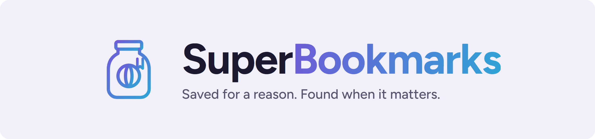
  </picture>
</h1>

https://github.com/user-attachments/assets/2b40dee2-304f-4e44-9e5c-49e4531d1da5

**One library for every link you've saved, on your own PC. Pages are copied as they come in, so a link still opens after
the site is gone.** SuperBookmarks is a free, open-source Windows app for anyone who saves links "for later" in more
than one place and then can't find them. Bring in your browser bookmarks, Telegram Saved Messages and WhatsApp chats,
save pages and posts with the browser extension, and sort what's new with a click or an arrow key. There's no account
and no cloud: your library is one file in your user folder.

<p align="center">
  <a href="https://github.com/browser-b0X/super-bookmark-manager/releases/latest/download/SuperBookmarkManager-Setup.exe"></a>
</p>
<p align="center">
  Free · Windows 10 and 11 · about 16 MB
</p>

[Quick start](#quick-start) ·
[Local, by design](#local-by-design) ·
[Where it runs](#where-it-runs) ·
[Website](https://browser-b0x.github.io/super-bookmark-manager/) ·
[Report a bug or suggest an idea](https://github.com/browser-b0X/super-bookmark-manager/issues/new/choose) ·
[Support the project](https://bio.site/browserb0x)

<picture>
  <source media="(prefers-color-scheme: dark)" srcset="docs/demo-dark.gif">
  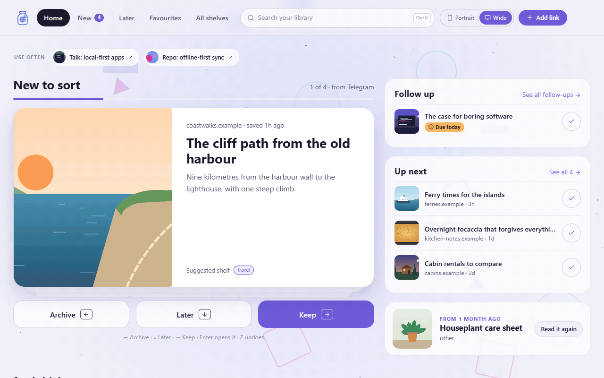
</picture>

<sub>The screens show made-up sample links.</sub>

## Features

Saving a link takes a second; finding it again can take forever. Students and researchers, creators and designers,
developers, cooks and travellers all end up with links in two browsers, a Telegram chat with yourself and a WhatsApp
chat, and the pages behind them don't wait: a quarter of all web pages that existed at some point between 2013 and 2023
were gone by October 2023
([Pew Research Center](https://www.pewresearch.org/data-labs/2024/05/17/when-online-content-disappears/)). The services
people trusted with their reading lists close too:
[Pocket shut down on 8 July 2025](https://9to5mac.com/2025/05/22/mozilla-announces-shutdown-of-pocket/), and
[Omnivore closed and deleted its users' data at the end of November 2024](https://wallabag.org/news/20241031-migrate-from-omnivore/).
SuperBookmarks keeps your links in one library on your own PC, with an offline copy of the page, so they don't depend
on anyone else's server.

- **One feed.** New links wait on Home one at a time for Keep, Later or Archive, with a click or an arrow key, beside
  Up next, follow-ups due and an older link, and each shelf with links is a row of pictures below.
- **Bring your links.** Import browser bookmarks (Chrome, Edge, Brave, Firefox), Telegram Saved Messages, WhatsApp
  chats, and Pocket and Instapaper exports, paste any link, or send the page you're on with the bookmark button on your
  bookmarks bar.
- **Browser extension.** Save the page you're on from the toolbar, a link from the right-click menu, or the posts you
  tick among those already loaded in your tab on X, Instagram and TikTok, in Chrome, Edge, Brave and Firefox.
  [Set it up](#browser-extension).
- **Saved copies.** The app can keep its own offline copy of each page (and of public X, TikTok and Reddit posts, and
  Instagram posts from your open tab), so a link still opens after the site changes or disappears.
  [What's kept](#saved-copies).
- **Organize your way.** Shelves, tags, notes, favourites, saved views and smart shelves, a search that says what it
  read, follow-up days, and any shelf grouped by website so a whole site moves at once, with Undo.
  [More](#organizing-your-links).
- **Creators.** Who made the posts you saved, from the posts themselves: names and handles across sites, merge two that
  are the same person, "new since you looked" after you run **Find creators in your saved posts**.
- **Clean up and undo.** Links of one post saved at two addresses are listed for you to merge; links you remove are
  remembered, so you can bring one back and an import doesn't; and History undoes bulk edits, merges, removals, imports
  and AI runs, not only the last.
- **Optional AI tidying with free keys.** Point the app at a [FreeLLMAPI](https://github.com/tashfeenahmed/freellmapi)
  router (one key in front of many free AI services) or a model on your PC, or add a single Gemini, Groq, OpenRouter or
  NVIDIA NIM key, and it suggests shelves, tags, clean titles and one-line summaries. [Set it up](#optional-ai).
- **Claude Desktop, no API key.** Search and tidy your library from a Claude chat with the SuperBookmarks extension for
  Claude Desktop, under your own Claude plan, with Undo for what it changes. [Set it up](#claude-desktop).

<sub>New in v0.4.0: a browser extension that saves the posts you see on X, Instagram and TikTok, Claude Desktop with no
API key, creators, a search that says what it read, and History, which undoes bulk changes.
[Release notes](https://github.com/browser-b0X/super-bookmark-manager/releases/latest)</sub>

<details>
<summary><b>See the screens</b></summary>

**Home:** new links wait one at a time; your shelves are rows of pictures below.

<p>
<picture>
  <source media="(prefers-color-scheme: dark)" srcset="docs/screenshots/home-dark.webp">
  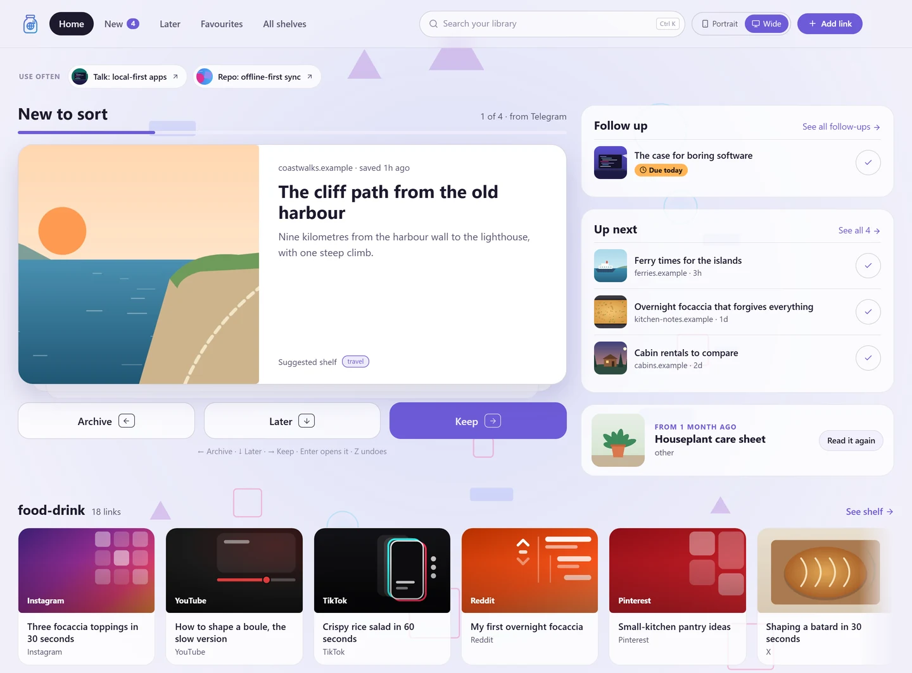
</picture>
</p>

**The library:** every link is a picture; point at one and its details rise.

<p>
<picture>
  <source media="(prefers-color-scheme: dark)" srcset="docs/screenshots/library-dark.webp">
  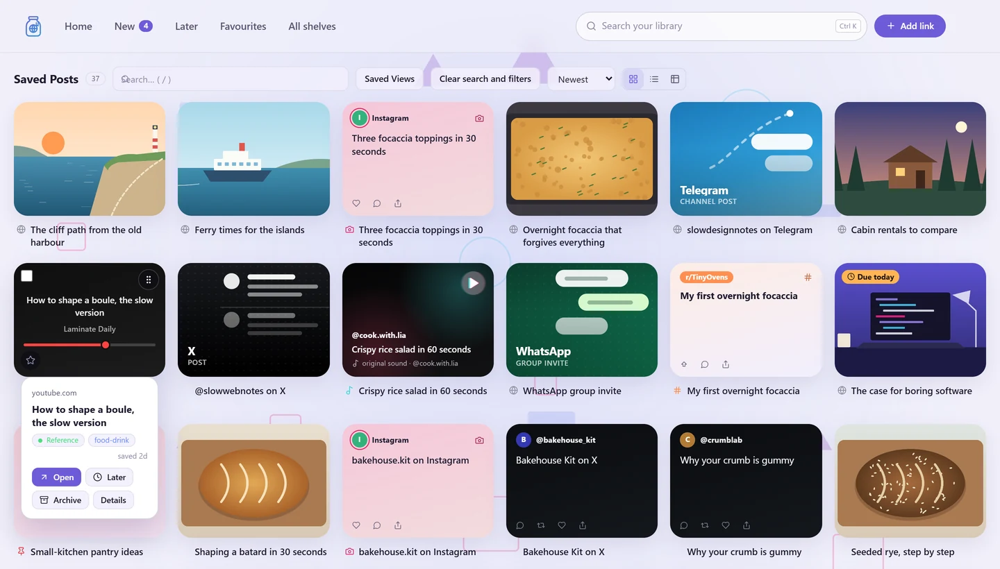
</picture>
</p>

**Saved copies:** the app keeps its own copy of a page, and it opens even after the site has changed or gone.

<p>
<picture>
  <source media="(prefers-color-scheme: dark)" srcset="docs/screenshots/saved-copy-dark.webp">
  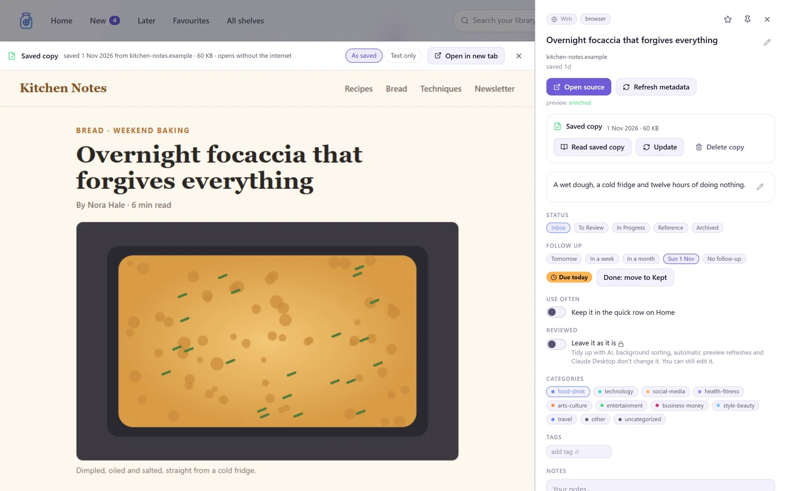
</picture>
</p>

**Sort a mess fast:** group a big shelf by website and move a whole site to another shelf at once.

<p>
<picture>
  <source media="(prefers-color-scheme: dark)" srcset="docs/screenshots/by-website-dark.webp">
  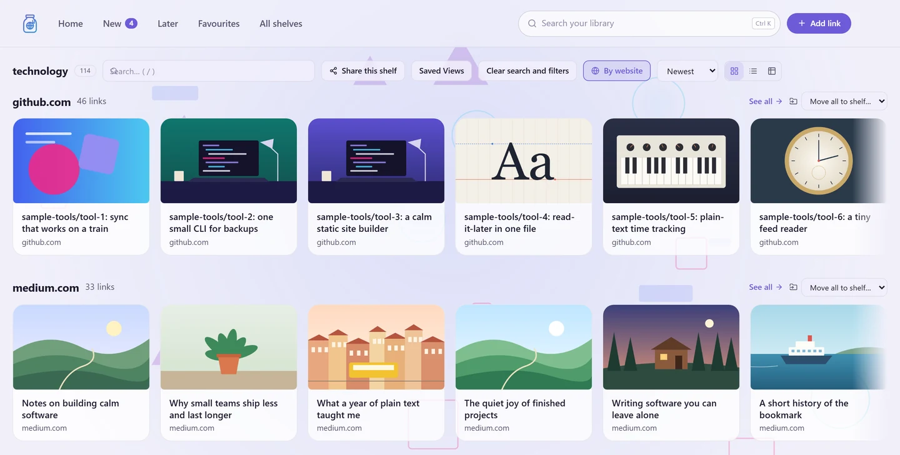
</picture>
</p>

**Save the posts you see:** the browser extension lists the posts already loaded in your tab on X, Instagram or TikTok;
tick the ones to keep.

<p>
<picture>
  <source media="(prefers-color-scheme: dark)" srcset="docs/screenshots/save-posts-dark.webp">
  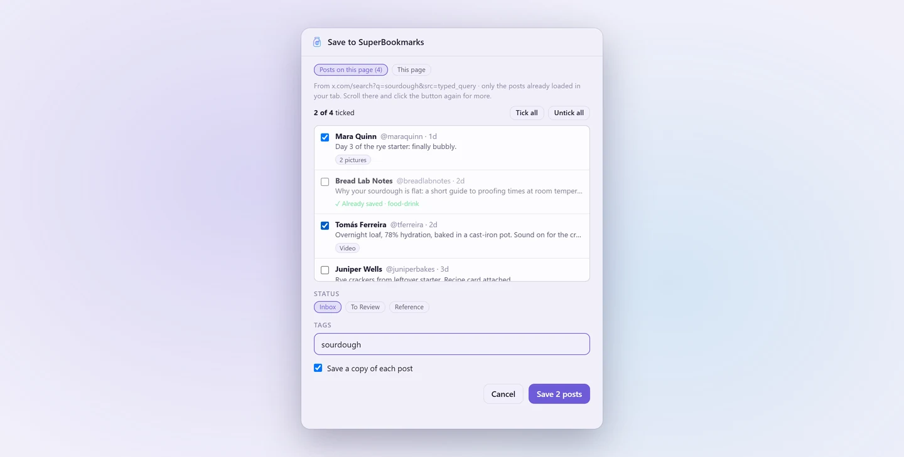
</picture>
</p>

**Creators:** who made the posts you saved, worked out from the posts themselves.

<p>
<picture>
  <source media="(prefers-color-scheme: dark)" srcset="docs/screenshots/creators-dark.webp">
  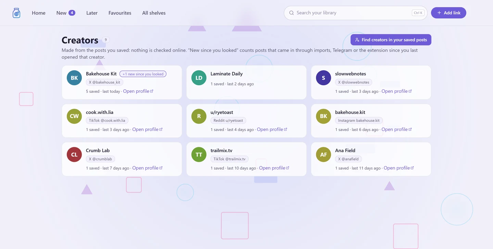
</picture>
</p>

**A search that says what it read:** `or`, `-word`, groups and dates, read back under the box.

<p>
<picture>
  <source media="(prefers-color-scheme: dark)" srcset="docs/screenshots/search-dark.webp">
  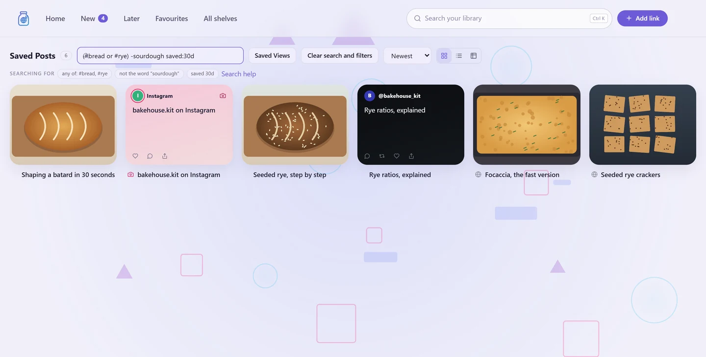
</picture>
</p>

**Clean up & undo:** the same post saved twice, links you removed, and a History of bulk changes to undo.

<p>
<picture>
  <source media="(prefers-color-scheme: dark)" srcset="docs/screenshots/cleanup-dark.webp">
  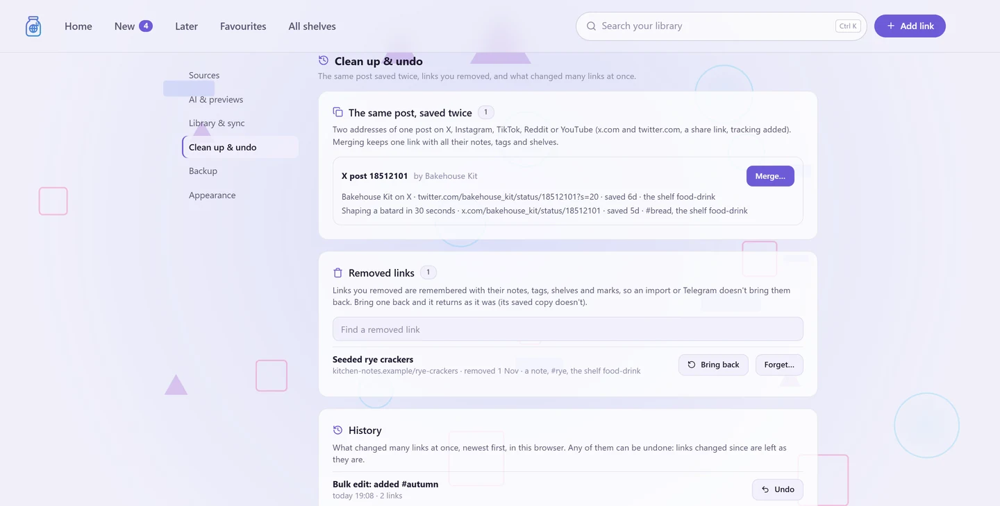
</picture>
</p>

<sub>Screenshots show sample links, not real user data.</sub>

</details>

## Local, by design

SuperBookmarks is for one person on one PC, with no account or cloud service behind it, and that is the point.

- **No account.** There's nothing to sign up for. Your library is one SQLite file in your user folder, with export and
  restore backups.
- **No cloud.** The app listens only on `127.0.0.1`, and there's no SuperBookmarks server for anything to go to. It does
  fetch previews and saved copies from the sites you saved: [Network activity](#network-activity) says what it contacts
  and when.
- **No tracking.** There's no analytics and no crash reporting, and the app never checks for a new version of itself.
- **No scanning.** The app reads only files you select and never scans live browser profiles. The browser extension
  reads a page when you press its button or menu item, unless you switch on its optional Download buttons.
- **No scripts in your copies.** Saved copies are inert: scripts never run in them.
- **No AI unless you ask.** Without a key the app never contacts an AI provider, and built-in keyword rules sort what
  you import.

## Quick start

1. Download `SuperBookmarkManager-Setup.exe` and its checksum from the
   [Releases page](https://github.com/browser-b0X/super-bookmark-manager/releases).
2. Run the installer for your Windows user. Administrator rights, Python, Node and npm are not required.
3. Launch **SuperBookmarks** from the Start Menu (a Desktop shortcut is optional), then
   [bring your links in](#bringing-links-in).

The installer is **unsigned**, so Windows SmartScreen or your antivirus may warn you. If SmartScreen shows "Windows
protected your PC", choose **More info**, then **Run anyway**. Check the file's SHA-256 against the published checksum
before running it:

```powershell
Get-FileHash .\SuperBookmarkManager-Setup.exe -Algorithm SHA256
```

The app opens in your browser at `http://127.0.0.1:5001`, or on another free port if that one is taken, and runs quietly
in the background. Launching it again reopens the running app. To stop it, use the menu behind the logo at the top left
(**Quit app**), or **Settings → Library & sync → Application → Quit SuperBookmarks**; it saves any pending changes
first. Installing or starting a newer version stops an older copy that is still running, so you always get the version
you installed.

### WinGet (pending availability)

A WinGet listing is prepared. It becomes available only after the release is published and the WinGet community listing
is accepted; until then this command does not work:

```powershell
winget install --id browser-b0X.SuperBookmarkManager --exact --source winget --scope user
```

WinGet uses the same Windows installer. It does not remove security warnings or add macOS/Linux support.
[Package preparation details](packaging/winget/README.md).

## Bringing links in

<p align="center">
  <picture>
    <source media="(prefers-color-scheme: dark)" srcset="docs/assets/readme-flow-dark.webp">
    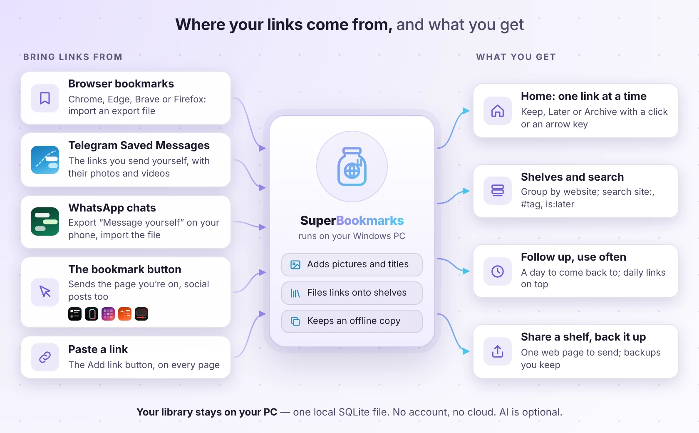
  </picture>
</p>

All imports are in **Settings → Sources**. Drop a file and the format is detected; you see a preview before anything is
saved. Reimports merge links without replacing your own edits.

- **Browsers:** an exported bookmark HTML file, a copied Chromium `Bookmarks` JSON file, or a copied Firefox
  `places.sqlite` file (copy it with the browser closed). The app reads only files you select; it never scans live
  browser profiles. You can leave folders out or file a folder onto a shelf.
- **WhatsApp:** on your phone, open a chat (for example *Message yourself*), choose **Export chat → Without media**, and
  import the `.txt` file or `.zip`. WhatsApp Desktop and Web cannot export chats.
- **Telegram:** connect your account (below) to refresh Saved Messages, or import a Telegram Desktop JSON export. A
  refresh keeps the photos, videos and audio sent with your links.
- **Pocket and Instapaper:** drop in the export file.
- **One page or one link:** use the [browser extension](#browser-extension), drag the bookmark button from **Settings →
  Sources → Save from your browser** onto your bookmarks bar, or paste a link with **Add link**.

Then the app tidies up. It fetches each link's picture, title and summary where the site has them, sorts imported files
and Telegram refreshes onto shelves (by keyword rules, or by [optional AI](#optional-ai) with free keys), and keeps an
offline copy that still opens if the page disappears. A link you paste or save from the browser stays off the shelves
until you choose one or AI does.

## Browser extension

1. Download `SuperBookmarks-extension-chrome.zip` (Chrome, Edge, Brave) or `SuperBookmarks.xpi` (Firefox) from the
   [Releases page](https://github.com/browser-b0X/super-bookmark-manager/releases).
2. Chrome, Edge, Brave: unzip it, open `chrome://extensions` (`edge://extensions` in Edge), turn on **Developer mode**,
   click **Load unpacked** and choose the folder. Firefox: open the `.xpi` file.
3. In SuperBookmarks, open **Settings → Sources → Save from your browser**, choose **Show a pairing code** and enter it
   in the extension's options.

The toolbar button opens the Save window for the page you are on; right-click a link for **Save link to SuperBookmarks**.
On X, Instagram and TikTok the window lists the posts already loaded in your tab and saves the ones you tick: it never
scrolls, opens posts or keeps a login, and it needs no permission for those sites. An open Instagram post's pictures and
video come from your tab. In the extension's options you can also switch on a **Download button on each post** for a
site: your browser asks for access to that site first, and each post you see there then gets a small button. While
SuperBookmarks isn't running, the extension keeps a page or an open post you save (up to 200 MB) and hands it over the
next time; a feed's list isn't kept. Until it is paired the extension sends nothing anywhere and tells you how to
pair. Pairing lets it add links and ask whether a page is saved; it can't read, change or delete anything else. If saving from a site stops working, **For support** in the options adds **Copy
page structure** to the right-click menu: what the page is built of, without its text, links, pictures or names, for you
to send with a bug report. Nothing is sent by itself.

## Telegram setup

1. [Sign in to Telegram's developer portal](https://my.telegram.org/auth), choose **API development tools**, and create
   an application to obtain your API ID and API hash.
2. Open **Settings → Sources** and find the Telegram section.
3. Save your developer credentials.
4. Choose **Connect Telegram**.
5. Enter your phone number.
6. Enter the verification code Telegram sends you.
7. Enter your two-step verification password only if requested.
8. Use **Refresh Telegram Saved Messages** to import messages explicitly.

API ID/Hash identify your Telegram application; they do not log you in. The Connect flow establishes your local account
session. There are no shared project API credentials. Refresh reads up to 200 recent messages (or a smaller configured
limit).

## Optional AI

No AI account or key is needed. Without one, imports are sorted by built-in keyword rules and the app never contacts an
AI provider.

To get suggestions for shelves, tags, clean titles and one-line summaries, open **Settings → AI & previews**. FreeLLMAPI
is the easy way; the single services sit under **Other providers** (each offers a free tier):

| Provider | Where to get a key |
| --- | --- |
| FreeLLMAPI | Install [FreeLLMAPI](https://github.com/tashfeenahmed/freellmapi) on your PC (Windows installer or Docker) and paste its key: one key in front of the free tiers of many providers, whose own keys you add in FreeLLMAPI |
| Local | An OpenAI-compatible server on your PC, such as [Ollama](https://ollama.com) |
| Google Gemini | [Google AI Studio](https://aistudio.google.com/apikey) |
| Groq | [Groq console](https://console.groq.com/keys) |
| OpenRouter | [OpenRouter keys](https://openrouter.ai/keys) (uses free models by default) |
| NVIDIA NIM | [build.nvidia.com](https://build.nvidia.com/settings/api-keys) |

Use **Test** to check a key. FreeLLMAPI is tried first when it's set up (the app asks it for its fastest models and a
short think, since a title and a shelf are quick answers); the others take over in turn when one is busy, rate-limited
or not running.

**Tidy up with AI** offers two ways. **Suggest** shows the suggestions for review, and nothing is saved until you accept
them. **Sort them in the background** can handle hundreds of links: it applies shelves and tags as it goes and keeps
going while you use the app, and **Undo the AI's changes** puts them back, leaving alone anything you changed since.
With **Keep sorting new links** ticked, links that arrive without a shelf, or are waiting when the app opens, are sorted
the same way by themselves. Shelves you chose by hand and titles you edited are never touched. When AI is used, the
title, link, text, folder and tags of the links being tidied, and your shelf names, are sent to that provider.

## Claude Desktop

With the SuperBookmarks extension for [Claude Desktop](https://claude.ai/download) you can ask Claude, in a chat, to find
links or file them on shelves, under your own Claude plan and with no API key.

1. In SuperBookmarks, open **Settings → AI & previews → AI providers → Claude Desktop** and choose **Make a token**.
2. Download `SuperBookmarks.mcpb` from the
   [Releases page](https://github.com/browser-b0X/super-bookmark-manager/releases) and double-click it: Claude Desktop
   asks to install it and for the token. Paste it there. If Windows doesn't open the file in Claude Desktop, install it
   from Claude Desktop itself, in **Settings → Extensions → Advanced settings → Install extension**, or right-click the
   file, choose **Open with**, pick **Claude** and choose to always use it.

The extension talks only to SuperBookmarks on your PC. The app lists its newest changes with **Undo**; it suggests new
shelves for you to create instead of making them, and it leaves links you marked **Reviewed** alone. What Claude reads
from your library becomes part of your chat with Claude.

## Saved copies

With **Automatically save a copy of new links** on, as it is unless you change it in **Settings → Library & sync → Saved
copies**, each new link gets a copy in the background. An Instagram post is copied only from the tab you have open, when
you save it with the bookmark button or the extension. A page that builds itself with scripts may lose most of its
content, and the copy says so. If a copy fails, the link stays in your library and its panel offers **Try again**.

With **Keep large videos and audio** on, X videos and Telegram videos and audio over 50 MB are kept too, up to 2 GB each.

## Organizing your links

- **Shelves and tags.** Shelves, tags (a tag can sit under others and have other names), notes, reading status,
  favourites, saved views and smart shelves built from rules, and platform filters.
- **Search.** It reads `or`, `-word`, "phrases", groups and dates (`site:`, `#tag`, `creator:`, `saved:30d`).
- **Many links at once.** Change many links at once with bulk edit, mark a link **Reviewed** so automation leaves it
  alone, and drag tiles into your own order.
- **Sort a mess fast.** Any shelf, and the links not on one yet, can be grouped by website, and a whole site moved to a
  shelf at once, with Undo.
- **Follow up and use often.** Give a link a day to come back to, or keep the ones you open every day in a quick row on
  Home.
- **Share a shelf.** Download a shelf or saved view as one self-contained web page to send to someone or put online;
  your notes stay out unless you tick them.
- **Good-looking cards without a thumbnail.** Posts with words are drawn in the spirit of their platform; posts from 14
  social and messaging sites with neither a picture nor words get artwork in their site's colours (no logos); in the
  library, plain web pages get a link-preview card with the site, title and description.
- **Themes.** Four themes (Classic dark and light, Lime, Coral); their fonts ship with the app.

## Local data and privacy

There is no central SuperBookmarks account. The installed app keeps its SQLite library, thumbnail cache, saved copies
(`archive\`), the optional video helper (`helpers\`), settings, AI keys (`ai.json`) and Telegram session in
`%LOCALAPPDATA%\SuperBookmarkManager\`.

Windows user-local file permissions protect these files; this is **not an encrypted credential vault**. Verification
codes and 2FA passwords are not stored. Keys, sessions and the thumbnail cache are excluded from the repository,
installer payloads and library backups. Anyone with access to your Windows account or its files may still obtain
sensitive information.

Backups are local library exports. Restore replaces the library you use with the backup's links. If that library has
links, they are saved first as a backup file in a `backups` folder beside it, so you can restore that file to go back.
Pictures are not in the backup: after a restore, **Settings → AI & previews → Previews & thumbnails → Fetch missing
previews** gets them again. Saved views, tags, creators and removed links are in the library and its backups; display
preferences and History live in your browser profile and are not.

## Network activity

The app is local-first, **not offline-only**:

- New links may be enriched with previews, which contacts the saved sites (and permitted redirects/images). Some
  pictures, such as YouTube's, load in your browser straight from their site. When a site asks the app to slow down, its
  previews wait for as long as it asks, up to an hour. Opening a link visits its site.
- Previews of some social sites don't use the app's own name, because those sites show preview details only to
  link-preview crawlers. Instagram links are read under Meta's crawler name. When Facebook, Threads, TikTok, LinkedIn,
  Pinterest, Instagram, X or Bluesky give no picture, the app asks once more under WhatsApp's. A saved copy of a TikTok
  post reads the post's page the same way when TikTok's embed data leaves out the caption and cover.
- The browser extension hands what you save only to the app on your PC (`127.0.0.1`). It reads a page only when you press
  its button or menu item, and only the tab you are on, unless you switch on its Download buttons. For an open Instagram
  post, a script in your tab fetches the post's pictures and video from Instagram's servers, without cookies. With its
  check mark on, it asks the app whether each page you open is saved.
- The Claude Desktop extension runs in Claude Desktop and talks only to the app on your PC, with the token you made.
  What Claude reads from your library (titles, addresses, shelves, tags, summaries, your notes and saved-copy text) goes
  to Anthropic as part of your chat.
- A creator's profile page is read only when you click **Refresh from the profile page**.
- Telegram is contacted when you connect, test, log out or refresh, and when Settings needs to check a saved login. Two
  switches add more, both off by default: **Check when the app starts** (once) and **Check again while the app is open**
  (on a timer). A refresh also downloads the photos, videos and audio sent with your links, from your own account, unless
  you turn that off; with **Keep large videos and audio** on, those over 50 MB download right after it, in the
  background.
- AI providers are contacted only when you add a key and run Test, a tidy-up or **Suggest from unfiled links**, or, if you
  turn on **Keep sorting new links**, when links arrive or wait that aren't on a shelf.
- Saved copies fetch the saved page (and its pictures and stylesheets) once, when the copy is made or updated; automatic
  copies can be turned off in Settings. X posts come from X's public embed data, TikTok posts from TikTok's public oEmbed
  data (or the post's page, when that data has no caption or cover) and Reddit posts from their public feed; no login is
  used or stored. An Instagram post's copy is made only from
  the tab you have open, when you press the bookmark button or the extension's button; a preview of an Instagram link
  reads its public page like any other.
- Sharing a shelf can fetch link pictures from their sites, for the page you download.
- TikTok and Reddit videos, and TikTok captions, need an optional helper, [yt-dlp](https://github.com/yt-dlp/yt-dlp) (Unlicense; its Windows
  build bundles GPL components). It is never shipped with the app: it is downloaded only when you ask for it in Settings,
  from yt-dlp's official GitHub release, and checked against the release's published SHA-256 list. Once it is installed,
  saving a video post looks at most once a week whether a newer release exists (only the checksum list is fetched);
  nothing new is downloaded or run until you choose **Update the helper**.

## Uninstall

Uninstall **SuperBookmarks** in Windows Settings → Apps. Program files and shortcuts are removed; your data is kept. For
complete removal, quit the app, keep any backups you want, and delete `%LOCALAPPDATA%\SuperBookmarkManager\` (and
`%LOCALAPPDATA%\SavedPostsDashboard\` if you used v0.1.0). Your browser keeps its own cached copy of the library, and the
two extensions stay until you remove them from your browser and from Claude Desktop.

## Where it runs

| Part | Status |
| --- | --- |
| The app | Windows, 64-bit, for one person on one PC. Installed and used on Windows 11. It isn't blocked on Windows 10, but it hasn't been tested there. There's no Mac, Linux or phone version yet, and no syncing between devices. |
| From source | Windows is the verified packaged-release platform. The test suites also run on Linux for every pull request. |
| Browser extension | Chrome, Edge and Brave (loaded unpacked), and Firefox 140 or newer. Automated tests run it in Chromium, Edge and Firefox. Brave hasn't been tried. |
| Posts on X, Instagram and TikTok | Read from the sites' pages as they are today, so a redesign can break them. Tested on stand-in pages so far, not yet on the real sites. |
| Claude Desktop extension | Claude Desktop on Windows, with the app running. Tested with a scripted client; filing links hasn't yet been confirmed in Claude Desktop itself. |
| Telegram | A real account's login is confirmed on Windows. Files over 50 MB have been tested with made-up data only. |

## How it's built

SuperBookmarks is a small local web app: a Python server runs on your PC and your browser
shows the screens, with no account or cloud service behind it.

| Part | Built with |
| --- | --- |
| Server | Python 3.12 and Flask, served by Waitress, listening only on `127.0.0.1` |
| Library | One SQLite file in your user folder |
| Screens | React 18 and TypeScript, built with Vite and styled with Tailwind CSS |
| Telegram | Telethon, with your own API ID |
| Browser extension | Manifest V3 JavaScript, one code base for Chrome, Edge, Brave and Firefox |
| Claude Desktop extension | A small Node server that speaks MCP, packaged as an `.mcpb` file |
| Windows installer | PyInstaller and Inno Setup |

The tests use made-up data only. `node frontend/tests/run.mjs` runs the logic, backend and
browser suites, and the same suites run on every pull request.

The maintainer is not a professional programmer, and much of the app was written with the
help of AI tools. Every change is reviewed carefully, and the test suites decide what is
safe to merge.

## Development

```bash
node frontend/tests/run.mjs
```

The suites need `npm ci` and `npm run build` in `frontend/`, the packages in `requirements.txt`, and Playwright with
Chromium; the command says what's missing. See [BUILDING.md](BUILDING.md) for prerequisites, build commands and outputs.

After the look changes, `node tools/make-docs-images.mjs` rebuilds the banners and demo GIFs in `docs/` from the real app
with made-up links.

The app was called Super Bookmark Manager, and only the name you see has changed: the code still says `SuperBookmarkManager`
for the data folder, install folder, program and WinGet ID, and `saved_posts` for the database.

## Contributing

Bug reports, ideas, fixes and tests are welcome. Please read [CONTRIBUTING.md](CONTRIBUTING.md) first: it covers the
ground rules (no personal data, nothing new sent over the network without an agreed issue), how to run the tests with one
command, and what a pull request needs. Every pull request runs the test suites automatically.

## Security

See [SECURITY.md](SECURITY.md) before sharing logs, screenshots or bug reports.

## Feedback & Suggestions

Help make **browser-b0X** better.

- 🐛 **Found a bug?** [Open an issue](https://github.com/browser-b0X/super-bookmark-manager/issues/new/choose).
- 💡 **Have an idea or question?** [Start a discussion](https://github.com/browser-b0X/super-bookmark-manager/discussions).
- 🤝 **Want to contribute?** Pull requests and improvements are always welcome.

## Support the project

<p align="center">
  <a href="https://bio.site/browserb0x">
    
  </a>
</p>

Ko-fi and Buy Me a Coffee are both on that page.

> Every contribution is appreciated, but never expected.<br>
> Using the project, reporting bugs, and sharing it with others helps too.

## License

The source code is [MIT](LICENSE), copyright 2026 browser-b0X. Dependency licenses are listed separately in
[THIRD_PARTY_LICENSES.md](THIRD_PARTY_LICENSES.md).

The MIT License lets you copy and change the code, but not present your version as SuperBookmarks: the **SuperBookmarks
name and jar logo are the project's trademarks**, not covered by that license and kept for the official project so that
people can tell it from modified copies. Forks are welcome under a different name and logo. See
[TRADEMARKS.md](TRADEMARKS.md). The only official sources are this repository and
[its website](https://browser-b0x.github.io/super-bookmark-manager/).

The app's fonts (Bricolage Grotesque, Figtree, Instrument Sans and Space Grotesk) are used under the SIL Open Font
License. Telegram, WhatsApp, X, Instagram, TikTok, Reddit, Claude, Chrome, Edge, Brave and Firefox are trademarks of their
owners; SuperBookmarks is an independent project and is not affiliated with or endorsed by any of them.
