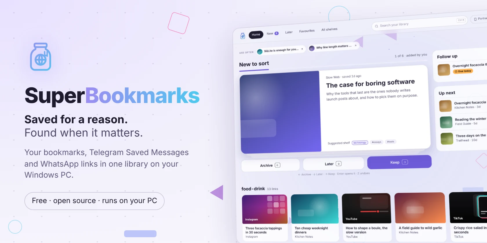
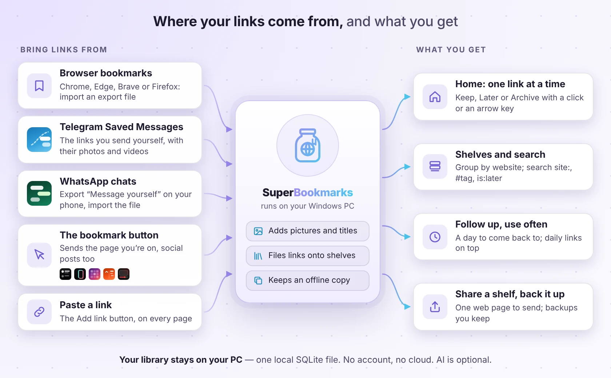
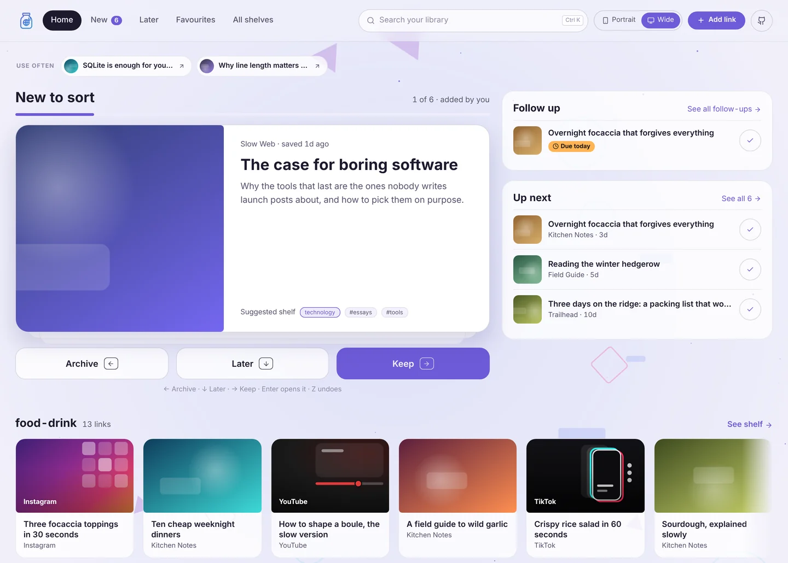
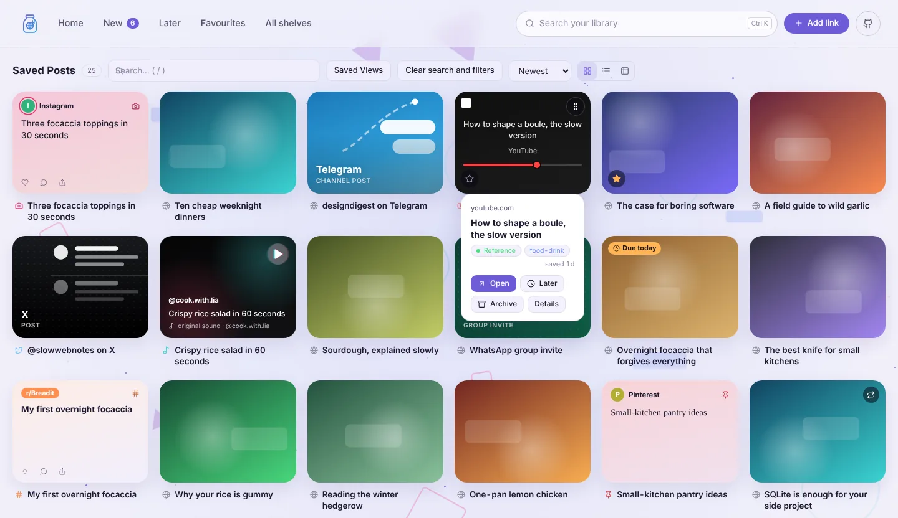
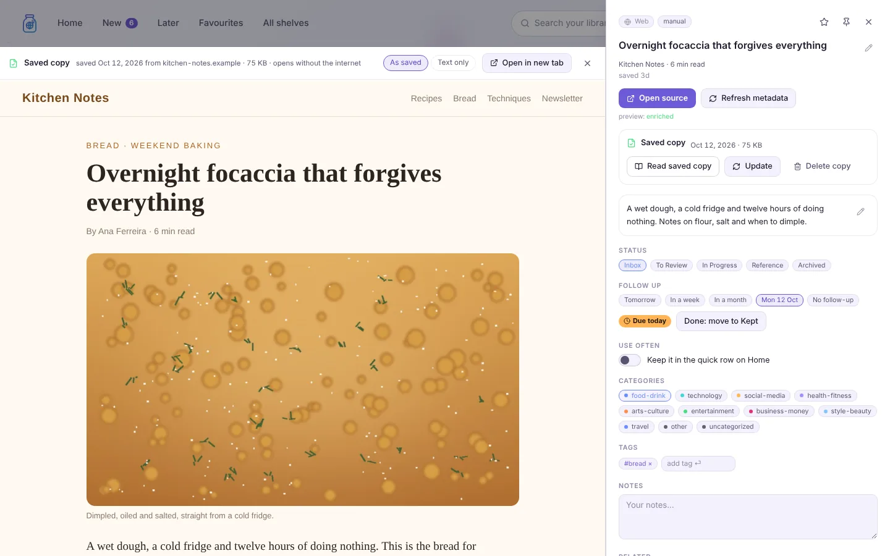
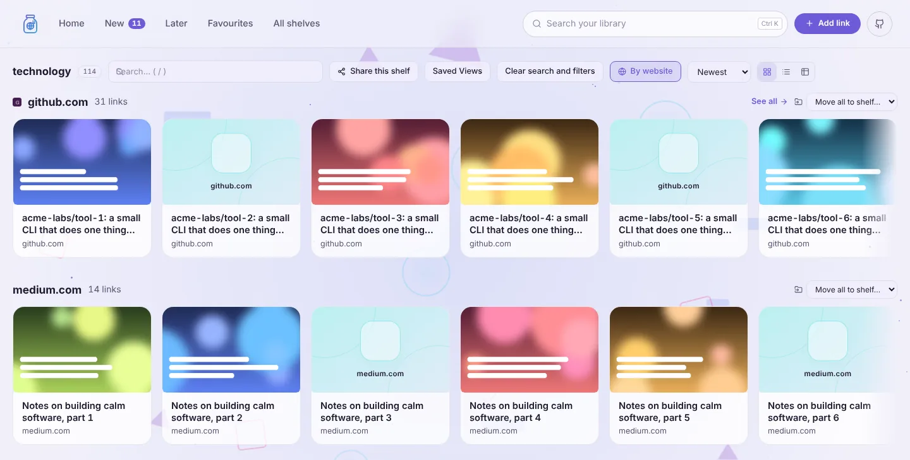

<p align="center">
  <picture>
    <source media="(prefers-color-scheme: dark)" srcset="docs/assets/readme-hero-dark.webp">
    
  </picture>

https://github.com/user-attachments/assets/2b40dee2-304f-4e44-9e5c-49e4531d1da5

</p>

<p align="center">
  <b>Every link you've saved — browser bookmarks, Telegram Saved Messages, WhatsApp chats and social posts — in one library on your own Windows PC.</b>
</p>

<p align="center">
  <a href="https://github.com/browser-b0X/super-bookmark-manager/releases/latest"><b>Download for Windows</b></a> ·
  <a href="https://browser-b0x.github.io/super-bookmark-manager/">Website</a> ·
  <a href="https://github.com/browser-b0X/super-bookmark-manager/issues/new/choose">Report a bug or suggest an idea</a>
</p>

<p align="center">
  <sub>New in v0.3.0: an offline copy of every page, a new Home, Telegram photos and videos, and AI tidying in the
  background. <a href="https://github.com/browser-b0X/super-bookmark-manager/releases/latest">Release notes</a></sub>
</p>

## At a glance

- **What:** a free, open-source app (MIT; formerly Super Bookmark Manager) that gathers
  the links you save into one library, adds pictures and titles, files them onto shelves
  and keeps an offline copy of each page.
- **Who:** anyone who saves links "for later" in more than one place and then can't find
  them: students and researchers, creators and designers, developers, cooks and
  travellers.
- **Where:** on your Windows PC. It opens in your browser at `127.0.0.1`, and your library
  is one SQLite file in your user folder. No account, no cloud.
- **When:** when you save (the bookmark button, a file you drop in, or a Telegram
  refresh), when you sort (Home shows new links one at a time), and when you come back
  (follow-up days, search, Up next).
- **Why:** saved links scatter across apps, the pages behind them disappear, and the
  services that held them close. [More below](#why-it-exists).
- **How:** install it (no admin rights), bring your links in, and sort them with a click
  or an arrow key. [See how it works](#how-it-works).

Good to know: SuperBookmarks is for one person on one Windows PC. There's no Mac, Linux
or phone version yet, and no syncing between devices.

## Why it exists

Saving a link takes a second; finding it again can take forever. Links pile up in two
browsers, a Telegram chat with yourself and a WhatsApp chat, and the pages behind them
don't wait: a quarter of all web pages that existed at some point between 2013 and 2023
were gone by October 2023
([Pew Research Center](https://www.pewresearch.org/data-labs/2024/05/17/when-online-content-disappears/)).
The services people trusted with their reading lists close too:
[Pocket shut down on 8 July 2025](https://9to5mac.com/2025/05/22/mozilla-announces-shutdown-of-pocket/),
and [Omnivore closed and deleted its users' data at the end of November 2024](https://wallabag.org/news/20241031-migrate-from-omnivore/).

SuperBookmarks keeps all of it in one library on your own PC, with an offline copy of
each page, so your saved links don't depend on anyone else's server.

## How it works

<p align="center">
  <picture>
    <source media="(prefers-color-scheme: dark)" srcset="docs/assets/readme-flow-dark.webp">
    
  </picture>
</p>

1. **Bring your links in.** Drop a browser bookmarks export, a WhatsApp chat export or a
   Telegram Desktop export into **Settings → Sources**, connect Telegram to read your
   Saved Messages, send the page you're on with the bookmark button, or paste a link.
   You see a preview before anything is saved.
2. **The app tidies up.** Each link gets its picture, title and summary, lands on a shelf
   (by keyword rules, or by optional AI with free keys) and gets an offline copy that
   still opens if the page disappears.
3. **You sort, find and come back.** Home shows new links one at a time: Keep, Later or
   Archive with a click or an arrow key. Shelves, tags and search find the rest,
   follow-up days bring links back when you need them, and a shelf can be shared as one
   web page.

## What it looks like

**Home:** new links wait one at a time; your shelves are rows of pictures below.

<p>
<picture>
  <source media="(prefers-color-scheme: dark)" srcset="docs/screenshots/home-dark.webp">
  
</picture>
</p>

**The library:** every link is a picture; point at one and its details rise.

<p>
<picture>
  <source media="(prefers-color-scheme: dark)" srcset="docs/screenshots/library-dark.webp">
  
</picture>
</p>

**Saved copies:** the app keeps its own copy of each page, and it opens even after the site has changed or gone.

<p>
<picture>
  <source media="(prefers-color-scheme: dark)" srcset="docs/screenshots/saved-copy-dark.webp">
  
</picture>
</p>

**Sort a mess fast:** group a big shelf by website and move a whole site to another shelf at once.

<p>
<picture>
  <source media="(prefers-color-scheme: dark)" srcset="docs/screenshots/by-website-dark.webp">
  
</picture>
</p>

<sub>Screenshots show sample links, not real user data.</sub>

## Features

- **One feed.** New links wait on Home one at a time: keep, save for later or
  archive each with a click or an arrow key. What comes next, follow-ups due and an
  old favourite sit beside it, and every shelf is a row of pictures below.
- **Bring your links.** Import browser bookmarks (Chrome, Edge, Brave, Firefox),
  Telegram Saved Messages and WhatsApp chat exports, or paste any link. A bookmark
  button in your browser's toolbar sends the page you are on to the app, and a Telegram
  refresh keeps the photos and videos sent with your links.
- **Saved copies.** The app can keep its own offline copy of each page (and of
  public X, TikTok, Reddit and Instagram posts), so a link still opens after the site
  changes or disappears. Copies are inert: scripts never run in them.
- **Good-looking cards without a thumbnail.** Posts with words are drawn in the spirit
  of their platform; posts from 12 social and messaging sites with neither a picture nor
  words get artwork in their site's colours (no logos); plain web pages get a
  link-preview card with the site, title and description.
- **Sort a mess fast.** Any shelf, and the links not on one yet, can be grouped by
  website, and a whole site moved to a shelf at once, with Undo.
- **Organize your way.** Shelves, tags, notes, reading status, favourites, saved
  views, platform filters and search (`site:`, `#tag`, `is:later`). Drag tiles into
  your own order.
- **Optional AI tidying with free keys.** Point the app at a
  [FreeLLMAPI](https://github.com/tashfeenahmed/freellmapi) router (one key in front of many
  free AI services) or a model on your PC — or add a single Gemini, Groq, OpenRouter or
  NVIDIA NIM key — and it suggests shelves, tags, clean titles and one-line summaries.
  Review them first, or let it sort hundreds of links in the background and undo it if
  you change your mind. Without a key, local keyword rules sort your links.
- **Follow up and use often.** Give a link a day to come back to, or keep the ones
  you open every day in a quick row on Home.
- **Share a shelf.** Download a shelf or saved view as one self-contained web page
  to send to someone or put online; your notes stay out unless you tick them.
- **Yours, on your PC.** Links live in a local SQLite library with export/restore
  backups. Four themes (Classic dark and light, Lime, Coral); their fonts ship with
  the app.

## Installation

Download `SuperBookmarkManager-Setup.exe` and its checksum from the
[Releases page](https://github.com/browser-b0X/super-bookmark-manager/releases).
Run the installer for your Windows user, then launch **SuperBookmarks**
from the Start Menu (a Desktop shortcut is optional). Administrator rights, Python,
Node and npm are not required.

The app opens in your browser at `http://127.0.0.1:5001` and runs quietly in the
background. Launching it again reopens the running app. To stop it, use the power
menu behind the logo at the top left (**Quit app**), or **Settings → Quit SuperBookmarks**;
it saves any pending changes first. Installing or starting a newer version stops an
older copy that is still running, so you always get the version you installed.

The installer is **unsigned** and may trigger Windows SmartScreen or antivirus
warnings. Check its SHA-256 against the published checksum before running it.


### WinGet (pending availability)

A WinGet listing is prepared. It becomes available only after the release is
published and the WinGet community listing is accepted; until then this command
does not work:

```powershell
winget install --id browser-b0X.SuperBookmarkManager --exact --source winget --scope user
```

WinGet uses the same Windows installer. It does not remove security warnings or
add macOS/Linux support. [Package preparation details](packaging/winget/README.md).

## Bringing links in

All imports are in **Settings → Sources**. Drop a file and the format is detected;
you see a preview before anything is saved. Reimports merge links without replacing
your own edits.

- **Browsers:** an exported bookmark HTML file, a copied Chromium `Bookmarks` JSON
  file, or a copied Firefox `places.sqlite` file (copy it with the browser closed).
  The app reads only files you select; it never scans live browser profiles.
  You can leave folders out or file a folder onto a shelf.
- **WhatsApp:** on your phone, open a chat (for example *Message yourself*), choose
  **Export chat → Without media**, and import the `.txt` file or `.zip`. WhatsApp
  Desktop and Web cannot export chats.
- **Telegram:** connect your account (below) to refresh Saved Messages, or import a
  Telegram Desktop JSON export.

## Telegram setup

1. [Sign in to Telegram's developer portal](https://my.telegram.org/auth), choose **API development tools**, and create an application to obtain your API ID and API hash.
2. Open **Settings → Sources** and find the Telegram section.
3. Save your developer credentials.
4. Choose **Connect Telegram**.
5. Enter your phone number.
6. Enter the verification code Telegram sends you.
7. Enter your two-step verification password only if requested.
8. Use **Refresh Telegram Saved Messages** to import messages explicitly.

API ID/Hash identify your Telegram application; they do not log you in. The Connect
flow establishes your local account session. There are no shared project API
credentials. Refresh reads up to 200 recent messages (or a smaller configured limit).

## Optional AI

No AI account or key is needed. Without one, imports are sorted by built-in keyword
rules and the app never contacts an AI provider.

To get suggestions for shelves, tags, clean titles and one-line summaries, open
**Settings → AI & previews**. FreeLLMAPI is the easy way; the single services sit under
**Other providers** (each offers a free tier):

| Provider | Where to get a key |
| --- | --- |
| FreeLLMAPI | Install [FreeLLMAPI](https://github.com/tashfeenahmed/freellmapi) on your PC (Windows installer or Docker) and paste its key: one key in front of the free tiers of many providers, whose own keys you add in FreeLLMAPI |
| Local | An OpenAI-compatible server on your PC, such as [Ollama](https://ollama.com) |
| Google Gemini | [Google AI Studio](https://aistudio.google.com/apikey) |
| Groq | [Groq console](https://console.groq.com/keys) |
| OpenRouter | [OpenRouter keys](https://openrouter.ai/keys) (uses free models by default) |
| NVIDIA NIM | [build.nvidia.com](https://build.nvidia.com/settings/api-keys) |

Use **Test** to check a key. FreeLLMAPI is tried first when it's set up (the app asks it
for its fastest models and a short think, since a title and a shelf are quick answers);
the others take over in turn when one is busy, rate-limited or not running.

**Tidy up with AI** offers two ways: **Suggest** shows the suggestions for review, and
nothing is saved until you accept them; **Sort them in the background** applies them as
it goes, keeps going while you use the app, and **Undo** puts every link back. With
**Keep sorting new links** ticked, links that arrive without a shelf are sorted the same
way by themselves. Shelves you chose by hand and titles you edited are never touched.
When AI is used, the title, link and text of the links being tidied are sent to that
provider.

## Local data and privacy

There is no central SuperBookmarks account. The installed app keeps its
SQLite library, thumbnail cache, saved copies (`archive\`), the optional video helper
(`helpers\`), settings, AI keys (`ai.json`) and Telegram session in
`%LOCALAPPDATA%\SuperBookmarkManager\`.

Windows user-local file permissions protect these files; this is **not an encrypted
credential vault**. Verification codes and 2FA passwords are not stored. Keys,
sessions and the thumbnail cache are excluded from the repository, installer
payloads and library backups. Anyone with access to your Windows account or its
files may still obtain sensitive information.

Backups are local library exports. Restore puts a backup's links into the library
you use. If that library has links, they are saved first as a backup file in a
`backups` folder beside it, so you can restore that file to go back. Pictures are not
in the backup: after a restore, Settings → Previews & thumbnails → Fetch missing previews
gets them again. Saved views and display preferences live in your browser profile and
are not part of backups.

## Network activity

The app is local-first, **not offline-only**:

- New links may be enriched with previews, which contacts the saved sites (and
  permitted redirects/images). Opening a link visits its site.
- Telegram is contacted only when you connect, test, log out or refresh, and once
  when the app starts if you turn on **Check when the app starts** (off by default).
  A refresh also downloads the photos and videos sent with your links, from your own
  account, unless you turn that off.
- AI providers are contacted only when you add a key and run Test or a tidy-up, or, if
  you turn on **Keep sorting new links**, when links arrive that aren't on a shelf.
- Saved copies fetch the saved page (and its pictures and stylesheets) once, when the
  copy is made or updated; automatic copies can be turned off in Settings. X posts come
  from X's public embed data and TikTok posts from TikTok's public oEmbed data; no login
  is used or stored. Instagram posts are read only from the tab you have open, when you
  press the bookmark button.
- TikTok and Reddit videos need an optional helper, [yt-dlp](https://github.com/yt-dlp/yt-dlp)
  (Unlicense; its Windows build bundles GPL components). It is never shipped with the
  app: it is downloaded only when you ask for it in Settings, from yt-dlp's official
  GitHub release, and checked against the release's published SHA-256 list. Once it
  is installed, saving a video post looks at most once a week whether a newer release
  exists (only the checksum list is fetched); nothing new is downloaded or run until
  you choose **Update**.

## Uninstall

Uninstall **SuperBookmarks** in Windows Settings → Apps. Program files and
shortcuts are removed; your data is kept. For complete removal, quit the app, keep
any backups you want, and delete `%LOCALAPPDATA%\SuperBookmarkManager\` (and
`%LOCALAPPDATA%\SavedPostsDashboard\` if you used v0.1.0).

## Building from source

See [BUILDING.md](BUILDING.md) for prerequisites, build commands and outputs.
Windows is the verified packaged-release platform.

## Contributing

Bug reports, ideas, fixes and tests are welcome. Please read
[CONTRIBUTING.md](CONTRIBUTING.md) first: it covers the ground rules (no personal data,
nothing new sent over the network without an agreed issue), how to run the tests with
one command, and what a pull request needs. Every pull request runs the test suites
automatically.

## Security

See [SECURITY.md](SECURITY.md) before sharing logs, screenshots or bug reports.

## Feedback & Suggestions

Help make **browser-b0X** better.

- 🐛 **Found a bug?** Submit a structured [Bug Report](https://github.com/browser-b0x/super-bookmark-manager/issues/new/choose)
- 💡 **Have an idea or question?** Start a discussion in [GitHub Discussions](https://github.com/browser-b0x/super-bookmark-manager/discussions)
- 🤝 **Want to contribute?** Start with [CONTRIBUTING.md](CONTRIBUTING.md); pull requests and improvements are always welcome.

## Support the project

<p align="center">
  <a href="https://ko-fi.com/browserb0x">
    
  </a>
  &nbsp;
  <a href="https://buymeacoffee.com/browserbox">
    
  </a>
</p>

> Every contribution is appreciated, but never expected.  
> Using the project, reporting bugs, and sharing it with others helps too.

## License

[MIT](LICENSE), copyright 2026 browser-b0X. Dependency licenses are listed separately
in [THIRD_PARTY_LICENSES.md](THIRD_PARTY_LICENSES.md).
The SuperBookmarks name and jar logo are not covered by the MIT license: forks need their
own name and icon ([TRADEMARKS.md](TRADEMARKS.md)).
